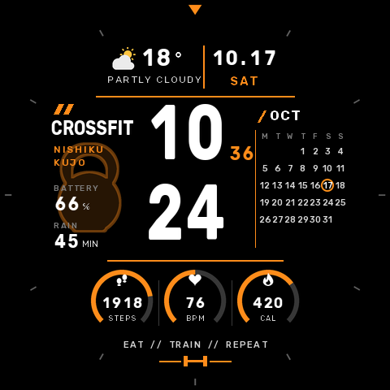
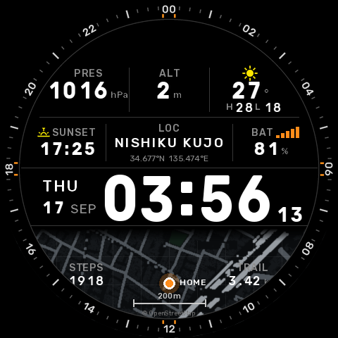
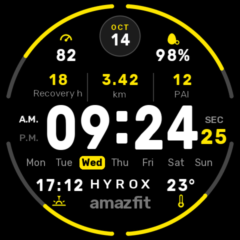

# HYROX Face（Amazfit Balance 3 用ウォッチフェイス）



HYROX 風デジタルウォッチフェイスのクローン。元デザインの「月」の位置には日付（月 + 日）を表示する。

- 対象: **Amazfit Balance 3 Ti 専用**（`app.json` の platforms で deviceSource 11145472 / 11145473 / 11145475 を指定）
- API: Zepp OS 3.0 以上

## 2 ページ構成

時刻のあたりをタップすると、HYROX ページ ⇔ データ + 地図ページが切り替わる。



2 ページ目: 気圧 / 高度 / 気温（最高・最低）/ 日の入り / 現在地（ローマ字）/ バッテリー / 曜日・日付 / 時刻 / 自宅周辺の地図（九条あたり、地図データ © OpenStreetMap contributors）/ 歩数 / 今日の移動距離

- 地図は普段は事前に作った自宅周辺の画像。連携アプリ **HYROX Link**（`../hyrox-link`）で同期すると、`watch-server` が描いた現在地まわりの地図と座標・最終同期（LINK ○分前）に置き換わる
- 縁は 24 時間の目盛りリング（真上が 0 時、1 周で 1 日）。オレンジの太い印が今の時刻、黄色の印と細い弧が日の出〜日の入り（座標から計算）、青い弧はこれから 2 時間で雨が降る時間帯
- 上部の傘と 8 本のバーは 2 時間先までの雨（15 分刻み、降る枠が青く伸びる）
- 固定地図の中心と範囲は `tools/gen_map.py` の `HOME` で変更
- ページはウォッチフェイスを入れ直す・再起動すると HYROX ページに戻る

## 表示内容（HYROX ページ）



| 位置 | 表示 |
| --- | --- |
| 上中央 | 日付（月・日） |
| 中央 | 時:分、秒、A.M./P.M.（12時間表示のとき点灯） |
| 曜日行 | 当日をハイライト |
| 下中央 | 現在地（Zepp アプリの天気の地名をローマ字に。例: 大阪市西区九条 → `NISHIKU KUJO`）。取れないときは amazfit ロゴ |
| 外周の弧 | 左上: 歩数目標 / 右上: バッテリー / 左下: カロリー目標 / 右下: 心拍 |
| **表示枠 ×7** | 左上・右上（アイコン + 数字）、中段 3 つ（数字 + ラベル）、左下・右下（数字 + アイコン）。**それぞれ自由に入れ替え可能** |

### 表示枠で選べるデータ

心拍 / 歩数 / カロリー / バッテリー / ストレス / EPOC（トレーニング負荷）/ VO2max / 回復時間 / Readiness / SpO2 / PAI / 脂肪燃焼 / スタンド / 距離 / 階段 / 気温 / 湿度 / UV / 気圧 / 高度 / 日の出 / 日の入り / 睡眠

- 入れ替え方: 時計の文字盤を長押し → 「編集」→ 枠をタップして上下にスクロールで選ぶ
- 初期設定: ストレス / バッテリー / EPOC / 歩数 / VO2max / 心拍 / カロリー
- 枠をタップすると、そのデータの純正アプリが開く
- 機種で使えないデータは選択肢に出ない。値が取れないときは `--`
- 常時表示（AOD）は時刻・日付・曜日のみ

## ファイル構成

```
app.json / app.js        Zepp OS アプリ設定
watchface/index.js       ウォッチフェイス本体
watchface/layout.js      座標・画像パス（自動生成）
assets/balance3/         画像素材（自動生成）
tools/gen_assets.py      画像素材・layout.js・preview.png の生成スクリプト
tools/complications.py   表示枠の位置と、選べるデータ・アイコンの定義
tools/page2.py           2 ページ目のレイアウト
tools/gen_map.py         OpenStreetMap から自宅周辺の地図を作る
watchface/romaji.js      地名→ローマ字の辞書（地名を足すときはここ）
tools/fonts/             Rubik フォント（SIL OFL 1.1）
```

デザインを変えるときは `tools/gen_assets.py` を編集して再生成する（Python 3 + Pillow）。

```sh
python3 tools/gen_assets.py
```

## ビルドと時計への転送（手元の PC で）

1. Node.js を入れて Zeus CLI をインストール: `npm i -g @zeppos/zeus-cli`
2. このフォルダで `zeus login`（Zepp 開発者アカウント）
3. `zeus preview` → 表示された QR コードをスマホの Zepp アプリ（プロフィール → 開発者モード → スキャン）で読み取る
   - `zeus build` で `dist/*.zab` だけ作ることもできる。作ったあと `zeus prune --ip` で中間ファイルを除くと 0.6MB 程度になる
   - シミュレーターで確認する場合は `zeus dev`

`app.json` の `appId`（1131180）は Zepp 開発者コンソールで発行したもの。

## ビルド済みファイル（release/）

- `release/HYROX_Face-1.0.0.zab` … ビルド済みのインストールパッケージ（Balance 3 Ti 用）
- `release/balance3ti-qr.png` … Balance 3 Ti への転送用 QR コード（**2026-10-21 まで有効**）。Zepp アプリ → プロフィール → 開発者モード → スキャン で読み取る。期限が切れたら `zeus preview` で作り直す
