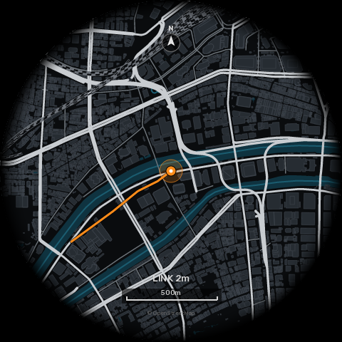
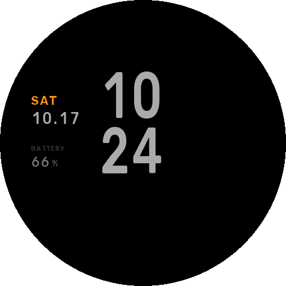

# HYROX Face（Amazfit Balance 3 用ウォッチフェイス）


1 ページ目は CROSSFIT デザイン、時刻をタップすると 2 ページ目（データ + 地図）に切り替わる。

- 対象: **Amazfit Balance 3 Ti 専用**（`app.json` の platforms で deviceSource 11145472 / 11145473 / 11145475 を指定）
- API: Zepp OS 3.0 以上

## 2 ページ構成

時刻のあたりをタップすると、CROSSFIT ページ ⇔ データ + 地図ページが切り替わる。


2 ページ目は 4 段: 気圧 / 高度 / 天気（最高・最低）→ 日の入り / 現在地（ローマ字）/ バッテリー → 曜日・日付 / 時刻 → 歩数 | LOCAL MAP | 今日の移動距離 と自宅周辺の地図（九条あたり、地図データ © OpenStreetMap contributors）

- 色の決まり: 時刻だけ白、ほかの値は明るいグレー、ラベルはグレー。オレンジは今の時刻・現在地・軌跡・電池残りわずかだけ、黄色は天気アイコンだけ
- 地図の道路は 3 段階（幹線は明るく太く / 一般道は細いグレー / 細い路地はごく暗く）。地図の上には文字を置かず、方位（北）と縮尺 200m だけ

- 地図は普段は事前に作った自宅周辺の画像。連携アプリ **HYROX Link**（`../hyrox-link`）で同期すると、`watch-server` が描いた現在地まわりの地図と座標・最終同期（LINK ○分前）に置き換わる
- 縁は 24 時間の目盛りリング（真上が 0 時、1 周で 1 日。目盛りは 1 時間 / 30 分 / 15 分で長さと太さが違う）。オレンジの印が今の時刻、白い三角と内側の細い弧が日の出〜日の入り（座標から計算）、青い弧はこれから 2 時間で雨が降る時間帯
- 上部の傘と 8 本のバーは 2 時間先までの雨（15 分刻み、降る枠が青く伸びる）
- **地図をタップすると全画面地図**（現在地が真ん中、2 ページ目より広い範囲、北・縮尺 500m・最終同期）。**真ん中をタップすると HYROX Link の地図画面**（現在地が真ん中、リューズか ＋/－ でズーム 13〜17 をすぐ切り替え）、まわりをタップで 2 ページ目に戻る。HYROX Link で同期すると届く（同期前は `SYNC HYROX LINK`）

  

- 固定地図の中心と範囲は `tools/gen_map.py` の `HOME` で変更
- ページはウォッチフェイスを入れ直す・再起動すると 1 ページ目に戻る

## 1 ページ目（CROSSFIT）

| 位置 | 表示 |
| --- | --- |
| 上 | 天気（今日の予報のアイコンと名前・今の気温）/ 日付 `10.17` と曜日 |
| 左 | CROSSFIT ロゴ、現在地（ローマ字 2 行、例: `NISHIKU` / `KUJO`）、時計の電池、雨（HYROX Link の同期データ: 何分後に降るか / `NOW` / `DRY`、3 時間以上同期が無ければ `--`）。後ろに薄くケトルベル |
| 中央 | 時・分を縦に、秒はオレンジ |
| 右 | 月の名前とカレンダー（日曜始まり、今日に丸、今週の行に薄い帯、日曜・祝日は赤み・土曜は青みのグレー、祝日の下に点）。**タップで来月**、もう一度タップか画面を付け直すと今月に戻る |
| 下 | 円弧メーター 3 つ（初期: 歩数 / 心拍 / カロリー）。**それぞれ自由に入れ替え可能** |

- メーターの入れ替え: 文字盤を長押し → 「編集」→ メーターをタップして上下にスクロールで選ぶ。選べるデータは心拍 / 歩数 / カロリー / バッテリー / ストレス / EPOC / VO2max / 回復時間 / Readiness / SpO2 / PAI / 脂肪燃焼 / スタンド / 距離 / 階段 / 気温 / 湿度 / UV / 気圧 / 高度 / 日の出 / 日の入り / 睡眠
- 円弧が伸びるのは目標や範囲があるデータ（歩数・カロリー・心拍・電池など）と距離（10 km で満タン）。階段などそれ以外は溝だけ
- メーターをタップすると、そのデータの純正アプリが開く
- データが 2 時間より古いと、地名を暗くして目印を出す。同期が止まっていれば `SYNC 9H`、同期はできているが位置（OwnTracks）が古ければ `POS OLD 4H`（2 ページ目は地図の上に同じ表示）
- 常時表示（AOD）: 時刻は普段と同じ位置、左の列に曜日（オレンジ）・日付・時計の電池

  

## ファイル構成

```
app.json / app.js        Zepp OS アプリ設定
watchface/index.js       ウォッチフェイス本体
watchface/layout.js      座標・画像パス（自動生成）
assets/balance3/         画像素材（自動生成）
tools/gen_assets.py      画像素材・layout.js・preview.png の生成スクリプト
tools/page1.py           1 ページ目（CROSSFIT）のレイアウト
tools/complications.py   メーターで選べるデータとアイコンの定義
tools/page2.py           2 ページ目のレイアウト
tools/gen_map.py         OpenStreetMap から自宅周辺の地図を作る
watchface/romaji.js      地名→ローマ字の辞書（地名を足すときはここ）
tools/fonts/             Rubik フォント（SIL OFL 1.1）
```

デザインを変えるときは `tools/gen_assets.py` を編集して再生成する（Python 3 + Pillow）。

```sh
python3 tools/gen_assets.py
```

## ビルドと時計への転送（手元の PC で）

1. Node.js を入れて Zeus CLI をインストール: `npm i -g @zeppos/zeus-cli`
2. このフォルダで `zeus login`（Zepp 開発者アカウント）
3. `zeus preview` → 表示された QR コードをスマホの Zepp アプリ（プロフィール → 開発者モード → スキャン）で読み取る
   - `zeus build` で `dist/*.zab` だけ作ることもできる。作ったあと `zeus prune --ip` で中間ファイルを除くと 0.6MB 程度になる
   - シミュレーターで確認する場合は `zeus dev`

`app.json` の `appId`（1131180）は Zepp 開発者コンソールで発行したもの。

## ビルド済みファイル（release/）

- `release/HYROX_Face-1.0.0.zab` … ビルド済みのインストールパッケージ（Balance 3 Ti 用）
- `release/balance3ti-qr.png` … Balance 3 Ti への転送用 QR コード（**2026-10-28 まで有効**）。Zepp アプリ → プロフィール → 開発者モード → スキャン で読み取る。期限が切れたら `zeus preview` で作り直す
