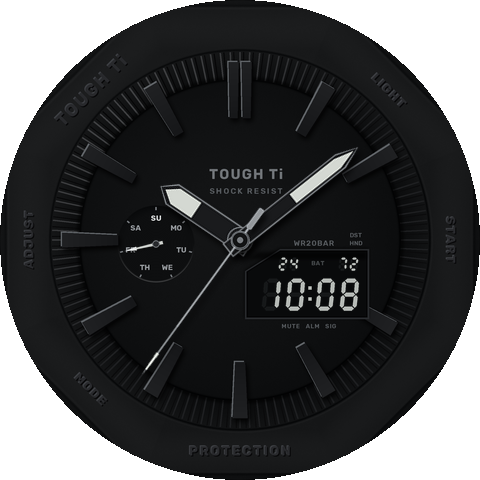
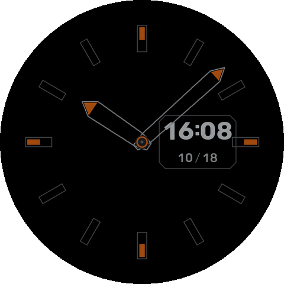

# TOUGH Ti（Amazfit Balance 3 Ti 用アナログ文字盤）

G-SHOCK（GA-2100）風の、真っ黒で無骨なアナデジ文字盤。HYROX Face とは別のウォッチフェイス。

 

- **ケース**: 円に近い控えめな八角形のベゼル。辺ごとに TOUGH Ti / LIGHT / START / PROTECTION / MODE / ADJUST の彫り込み
- **インデックス**: 見返しの上まで伸びる、上が平らな台形の黒いブロック。左上の縁が光り、右下に影。12 時は 2 本、3 時は液晶窓
- **見返し**: 歯車のように並んだ細い溝
- **針**: 黒い刃に夜光の帯の時針・分針、グレーの秒針
- **曜日**（9 時のサブダイヤル）: SU〜SA を指す針
- **液晶窓**（3〜4 時、左上を斜めに落とした窓）: デジタル時刻、上の段に日付と電池残量。消えているセグメントもうっすら見える
- 本物のロゴ（G-SHOCK / CASIO）の代わりに TOUGH Ti と書いている（公開リポジトリのため）
- **常時表示（AOD）**: 黒地にインデックスの輪郭、液晶の時刻、中抜きの時分針
- 心拍などの数値は出さない。編集（中身の入れ替え）もなし

## ファイル

```
app.json               アプリ設定（appId 1000002 は仮）
watchface/index.js     文字盤（TIME_POINTER・IMG_WEEK・IMG_TIME・IMG_DATE・TEXT_IMG）
watchface/layout.js    tools/gen.py が作る座標と画像の一覧
tools/gen.py           文字盤の絵をすべて描く（Python 3 + Pillow + numpy）
tools/fonts/           Rubik フォント（SIL OFL 1.1）
```

デザインを変えるときは `tools/gen.py` を編集して再生成する。

```sh
python3 tools/gen.py
zeus build && zeus prune --ip
```

## ビルド済みファイル（release/）

- `release/TOUGH_Ti-1.0.0.zab` … インストールパッケージ
- `release/balance3ti-qr.png` … 転送用 QR コード（**2026-10-31 まで有効**）。Zepp アプリ → プロフィール → 開発者モード → スキャン
